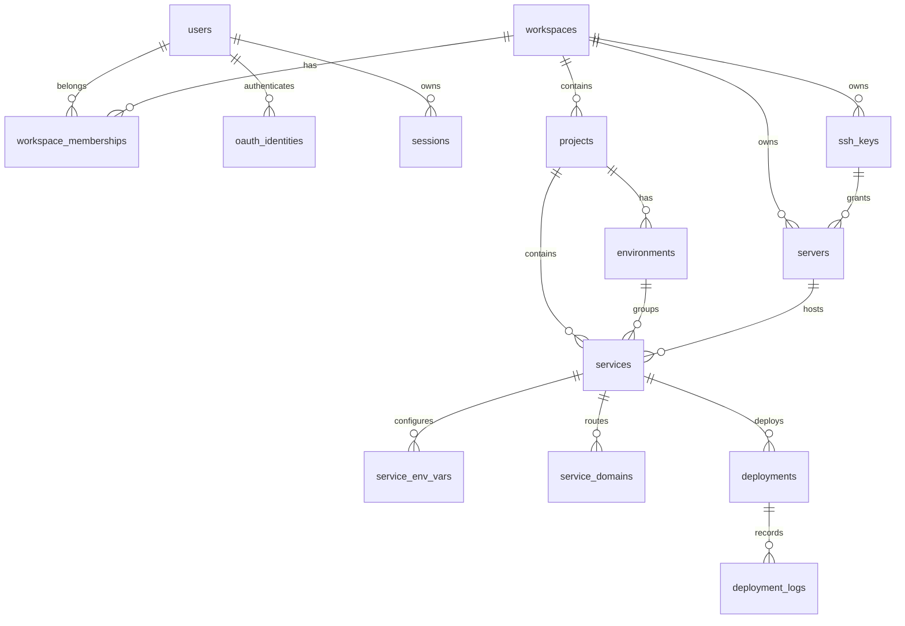

# Data model on `main`

Source of truth: `api/db/migrations/0001_*.sql` through `0025_*.sql`, SQL in `api/db/queries/`, and the runtime wrappers in `api/db/`. Table names below describe the schema **after all 25 migrations**, not earlier intermediate names.

| Entity | Important columns / constraints |
| --- | --- |
| `users`, `oauth_identities` | Unique user email and unique `(provider, provider_user_id)`; password hashes and provider identities, not OAuth access tokens (`0003`, `0004`). |
| `workspaces`, `workspace_memberships`, `sessions` | Owner user, unique `(workspace_id, user_id)` membership; session token, user, workspace and expiry (`0003`, `0007`). |
| `ssh_keys`, `servers` | Workspace-owned encrypted private key; server host/port/user, SSH key and proxy status. Composite `(ssh_key_id, workspace_id)` FK prevents cross-workspace key use (`0006`, `0008`, `0014`, `0016`). |
| `projects`, `environments` | Workspace project and cascading project environments (`0018`). |
| `services` | Image, container name, container/host port, kind constrained to `application`, workspace/server/project/environment IDs; unique `(container_name, server_id)` (`0009`, `0011`, `0018` through `0022`). |
| `service_env_vars`, `service_domains` | Env key unique per service, encrypted value; globally unique domain, at most one primary domain per service; both cascade on service deletion (`0010`, `0016`, `0018`). |
| `deployments`, `deployment_logs` | Service/workspace, status, creation time, encrypted nullable configuration snapshot (`0023`); unique in-progress deployment per service (`0024`); ordered logs indexed by deployment and order (`0001`, `0002`, `0012`, `0017`). |

`0009` enforces server/workspace consistency in the database. Some relationships (for example service to its chosen project/environment) use individual FKs; inspect handler scoping as well as the schema before assuming every cross-workspace combination is impossible. A deleted service cascades to deployment rows (`0012`) and thus may affect history; the deployment log FK in `0001` has no explicit cascade, so deletion behavior also depends on handler/transaction behavior. There is no configured time-based data retention on `main`.

Migrations are embedded in `api/db/migrate.go` with Goose; `api/cmd/migrate/main.go` supports `up` and one-step `down`. `bun run setup` and `bun run db:migrate` guard **local Compose** database identity in `scripts/setup.ts`; the raw Go command has no such guard, so verify `DATABASE_URL` before invoking it elsewhere. `0018` adds NOT NULL `project_id` and `environment_id` to services with no data backfill. `0024` marks older simultaneous in-progress deployments failed; `0025` marks formerly ready proxies degraded for one-time upgrade. Back up and test migrations on existing data; `down` does not restore lost rows or remote Docker/Traefik state.

Branch-only schema additions: [GitHub source import](../features/github-import.md) adds `0026_service_sources.sql`; [metrics MVP](../features/metrics.md) adds `0027_server_monitoring.sql` through `0029_drop_monitoring_private_address.sql`. Goose ordering is important when integrating them; see [branch audit](../audits/branch-audit.md).
