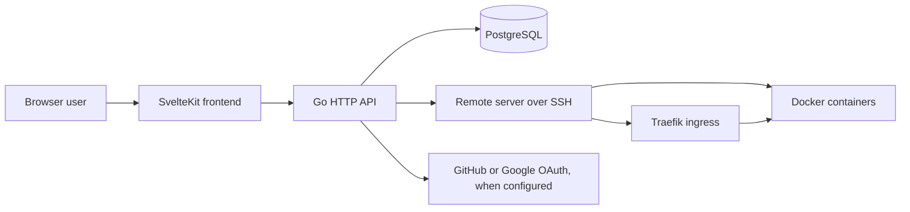
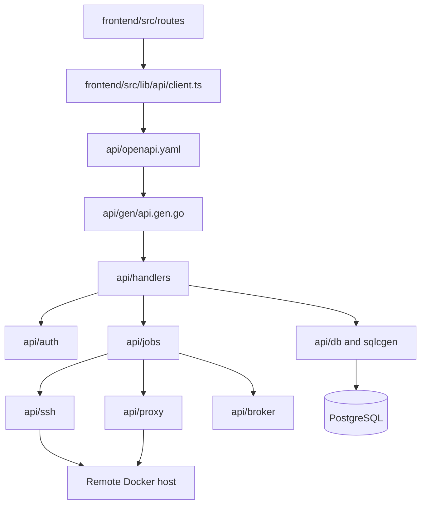
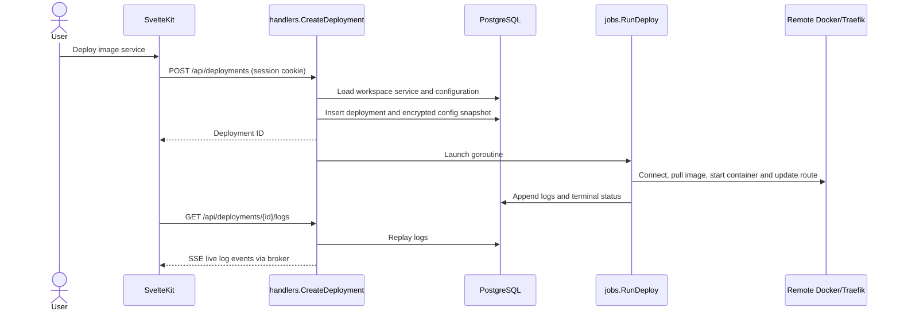

# Architecture on `main`

StageZero manages workspace-scoped projects, environments, image-based services, SSH servers, deployments, and domains. This page describes `origin/main` at `0e3c0ab`; [source import](../features/github-import.md) and [metrics](../features/metrics.md) are branch-only work.

## System context

`frontend/src/lib/api/client.ts` sends cookie-authenticated `/api` requests. `frontend/vite.config.ts` proxies browser requests to port 8080 **in development**; server-side route loads use `API_BASE_URL` (`frontend/src/routes/(app)/+layout.server.ts`). Production frontend routing and hosting are not configured in this repository.

## Modules and interfaces

`api/main.go` registers generated routes through `gen.HandlerWithOptions` and registers OAuth callbacks separately; generated `CookieAuthScopes` invokes `auth.RequireAuth`. `api/handlers` validates workspace ownership and roles before operations. `api/db/queries` is the SQLC input, `api/db/sqlcgen` and `api/gen` are generated output. The API contract is `api/openapi.yaml`; `frontend/src/lib/api/v1.d.ts` is generated from it. These generated artifacts must remain in sync.

The key seam for deployments is `jobs.RunDeploy(jobs.DeployConfig)`: the handler snapshots a service configuration and creates an in-progress row before starting the job; the job owns remote Docker and Traefik transitions. It runs as an **in-process goroutine**, not a separate worker or durable queue. `jobs.StartDeploymentReconciler` attempts to resolve interrupted deployments at API startup. `api/broker` streams deployment logs to authenticated SSE clients; rows in PostgreSQL provide replay (`handlers.GetDeploymentLogs`). `jobs.StartDomainReconciler` and TLS reconciliation manage domain/proxy state. No external job broker exists in `main`.

## Deployment flow

With domains, `api/jobs/deploy.go` checks proxy readiness, starts a candidate, verifies health and route cutover, and can restore the previous route. Without domains, it stops and replaces the existing container, so zero downtime is not guaranteed. Traefik's watched file provider and Docker integration live in `api/proxy`; proxy state is stored on the **remote server**, not in local Compose. Domain readiness requires DNS and external HTTPS access.

## Dependencies and constraints

Go 1.25, PostgreSQL 18 (`pgx/v5`, SQLC, embedded Goose migrations), SvelteKit/Svelte 5, TypeScript, Bun 1.4.3 workspace with Node 22 for Vite, Docker Engine/Compose on target hosts, and SSH key access. Local `compose.yaml` provisions **only PostgreSQL**. GitHub/Google OAuth on `main` is account sign-in (`api/auth/oauth.go`), not GitHub repository authorization. The API listens on `:8080` (`api/main.go`). Session state lives in PostgreSQL; OAuth state is in API process memory.

## Known risks and proposals

**Current:** `ssh.NewClient` uses `InsecureIgnoreHostKey` (`api/ssh/client.go`), which exposes remote administration to host impersonation. No production deployment manifest or SvelteKit production adapter is selected; see [deployment](../operations/deployment.md). The `0018` migration adds required project/environment references to pre-existing services without a backfill, so test upgrades on real pre-0018 data before production use. Source-build and monitoring additions are **not** present on `main`.

**Proposed, not implemented:** pin SSH host keys, prove the pre-0018 migration on a copy of real data, select a frontend production adapter and a documented deployment topology. Do not add a new worker/queue just because in-process jobs are unfashionable; first verify restart recovery against real remote containers.
