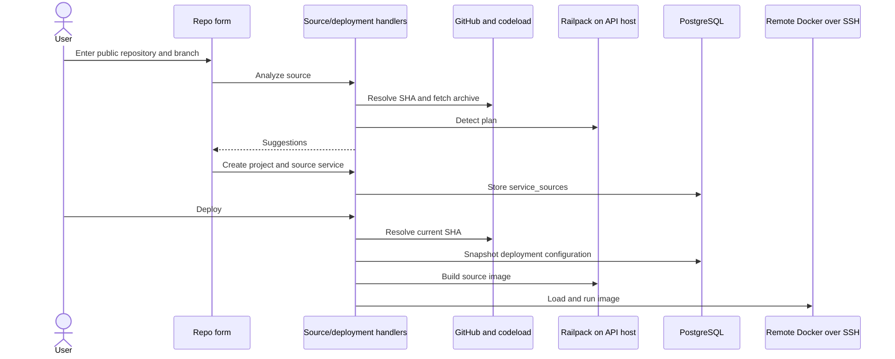

# GitHub repository import (feature branch only)

Source: local/remote `feat/github-import` at `1dad577`, compared with `origin/main` at `0e3c0ab` on 2026-10-16. **Not on `main`; not approved for merge.** This is a public-GitHub-repository import and source-build path, not a GitHub App, private-repo authorization flow or webhook-based continuous deployment. GitHub OAuth on `main` signs in users and does not grant repo access.

## User journey and seams

1. `frontend/src/lib/components/app/RepoStarterForm.svelte` and `frontend/src/routes/(app)/(builder)/projects/new/repo/+page.svelte` accept a public GitHub URL and selected branch, call `POST /api/source/analyze`, then create a project/service. The existing project builder also exposes repository-backed service creation; service source details are edited/displayed alongside existing service configuration.
2. `api/handlers/source.go::AnalyzeSource` parses a public `github.com` URL, resolves the branch to a commit via `git ls-remote`, downloads the archive from `codeload.github.com`, and asks Railpack to detect a build plan (`api/source/source.go`). Analysis returns suggested service properties, not a persisted artifact.
3. `api/db/migrations/0026_service_sources.sql` adds a one-to-one `service_sources` row keyed by `service_id`: GitHub owner/repo/branch, optional root dir, JSON detection metadata. `api/handlers/service_sources.go` and `api/db/service_sources.go` persist/read it with workspace-aware service handling. Generated Go/TS APIs follow `api/openapi.yaml`.
4. `api/handlers/deployments.go::CreateDeployment` resolves an uncached commit SHA, assigns a `stagezero/` source image tag and snapshots deployment inputs. `api/jobs/deploy.go` fetches/builds with Railpack, transfers/loads the image via SSH and runs the existing deployment/Traefik flow. A one-minute branch-head cache is for the UI badge, **not** for selecting the deployment SHA (`api/source/source.go`). `api/Dockerfile` includes Railpack v0.37.0; normal local `bun run setup` does not install Railpack.

## Limits and open risks

- **Blocking security/resource exposure:** `POST /api/source/analyze` is public in `api/openapi.yaml` and `api/handlers/source_test.go` explicitly exercises anonymous access. Every call may download up to 500 MiB **compressed** and run Railpack for 90 seconds; there is no concurrent-work bound. `api/source/source.go::extractTarball` has no cumulative decompressed-byte bound, and extraction doesn't check cancellation inside the tar-copy loop. Authenticate/limit and test resource behavior before exposure.
- **Blocking secret handling:** `api/source/source.go::Prepare` passes environment secrets as `railpack prepare --env KEY=VALUE` subprocess arguments; they can appear in process listings on the API host. Build-time and runtime secret handling need a reviewed path before merge.
- The source-service image field can be edited/saved in `ServiceWorkspace.svelte`/service handlers but deployment selects a SHA-derived image; the editable field gives misleading feedback. Make the field read-only/derived for source-backed services or define the intended override behavior and test it.
- The new-project flow creates a project before creating a service; a second request failure or retry can strand an empty project. The parser accepts pasted `/tree/<branch>` URLs but ignores the branch path and defaults to `main` unless the user selects another branch.
- Production image packaging exists, but local development lacks Railpack setup; `api/Dockerfile` still names the old `uploy` binary/user. The compiled tests do not prove the real archive -> Railpack -> remote Docker journey.

## Verification gates

Run `cd api && go test ./... && go vet ./...`, `bun run --cwd frontend check`, `bun run lint` and `bun run build:web` on the branch, then test authorization and bounded resource use with an anonymous caller and a high-expansion archive. Test that secrets do not appear in process arguments/logs, an unsupported repo produces an actionable error, a pasted branch URL uses the chosen branch, a failed service create does not strand a project, and edits do not pretend to change the SHA-derived image. Finally run a **disposable** real public-repo import, source build and remote deployment, including failed-build/retry and restart, checking logs, database rows, image tags and container state. This live journey was **not** run in this audit. See [branch audit](../audits/branch-audit.md) for recorded commands and readiness.
