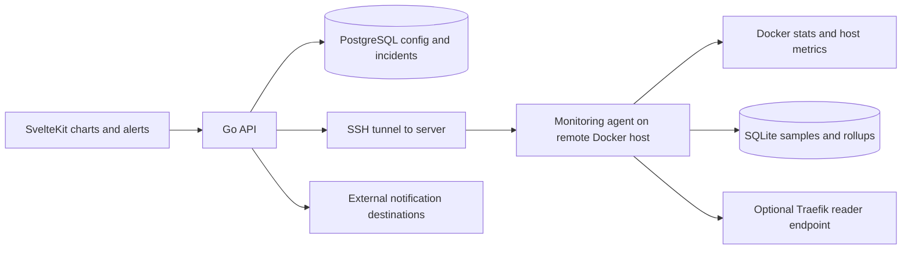

# Metrics and alerts MVP (feature branch only)

Source: local `feat/metrics-mvp` at `7e511e7`, compared with `origin/main` at `0e3c0ab` on 2026-10-16. The remote-tracking metrics branch was at `d037dcc` at audit time; the local merge commit has **not** been pushed. This design is not on `main` and is **not merge-ready**.

## Topology and flow

`api/handlers/monitoring.go` enables monitoring by storing tokens/configuration on a server, provisioning an agent container via `api/monitoring/agent.go`, then reconciling status; API-to-agent calls use SSH tunnel/loopback. The agent (`monitoring/` is a **separate Go module**) samples Docker container and host stats, keeps recent/latest samples and SQLite history with rollups and retention. Optional public reader exposure is via Traefik/FQDN, not an open host port; the agent's host port binds loopback. The agent mounts `/var/run/docker.sock` and host filesystems read-only, a substantial host-trust boundary even with a loopback API. Deployment labels bind samples to deployment IDs; new containers carry both `stagezero.deployment_id` and a legacy `uploy.deployment_id` compatibility label for the previously published monitor image.

`api/handlers/metrics.go` and server/self metrics handlers aggregate current/history samples into OpenAPI responses. Project charts live in `frontend/src/routes/(app)/(builder)/projects/[id]/metrics/+page.svelte`; server monitoring configuration is in `MonitoringDialog.svelte`. `api/alerts/evaluator.go`, `api/jobs/alerts.go` and `api/alerts/notifier.go` evaluate scoped conditions and dispatch to configured channels; `frontend/src/routes/(app)/(dashboard)/alerts/` shows rules/events/channels. PostgreSQL tracks rule/channel config and firing/resolved incidents, whereas samples remain on the agent's SQLite volume. A separate `.github/workflows/monitoring-image.yml` builds/tests/publishes a monitoring image to `ghcr.io/wahyus002/uploy-monitor`; neither that workflow nor a published production image was exercised here.

Schema: `0027_server_monitoring.sql` adds enabled/status, token, retention (1–30 days), port and unique optional FQDN fields on `servers`; `0028_alerts.sql` adds `notification_channels`, `alert_rules`, rule/channel mapping and `alert_events`, including unique active incident per `(rule_id,target_id)`; `0029_drop_monitoring_private_address.sql` removes an address made obsolete by the SSH tunnel. Stored channel configuration is encrypted at rest, but read APIs must still redact secrets.

## Known gaps

- **History correctness:** `GetProjectMetricsHistory` in `api/handlers/metrics.go` discards deployments created before the requested window **before** asking the agent for historical samples; an older still-running deployment disappears from a seven-day chart. The limit of 100 recent deployments can also hide earlier activity. Fix and test against timestamped samples.
- **Secret exposure:** `ListNotificationChannels` in `api/handlers/alerts.go` returns decrypted channel configuration, including webhook destinations, to any workspace session member. Return redacted metadata by default, and verify access policy and edit behavior.
- **False alerts / false recovery:** `monitoring/main.go::collector.collect` replaces latest metrics on Docker read error while `/health` remains healthy. `api/jobs/alerts.go` interprets missing service samples as stopped; `alerts.violation` treats unreachable as non-violation for several rule types, so `Tracker.Evaluate` can resolve an active incident despite lack of evidence. Distinguish unknown from down and only resolve on fresh valid observations.
- **Partial provisioning:** `EnableServerMonitoring` persists tokens before remote setup; rollback uses the canceled request context and ignores its error. `RotateServerMonitoringReaderToken` changes the remote agent before persisting the new token, without a compensating action on DB failure. Exercise interruption and DB/SSH failure paths.
- **Secondary:** SQLite rollup band boundaries can omit points, chart points are distributed by index while deploy markers are placed by timestamp, agent history errors can become HTTP 200 with empty results, rule/channel writes lack one transaction, and the UI has create/delete channel and create rule but not complete rule lifecycle. These deserve focused tests after the correctness/security gates.

## Verification gates

Run API and agent module `go test ./...` and `go vet ./...` separately, then Svelte check/lint/build and setup tests. Add fake-clock tests for long-lived deployment history, rollup boundary points, sample read failures, suppressed/unknown/down/recovered transitions and channel redaction/access. Simulate request cancellation and DB failure during enable/rotation, checking both stored tokens and remote container/route. On a disposable Docker/SSH host, build the agent image, provision and rotate it, confirm live and retained SQLite metrics, charts aligned by wall time, notification delivery and recovery, host port confinement and restart/retention behavior. A live agent/notification integration was **not** run in this audit. See [branch audit](../audits/branch-audit.md).
